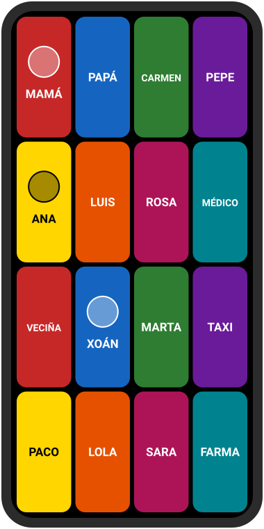
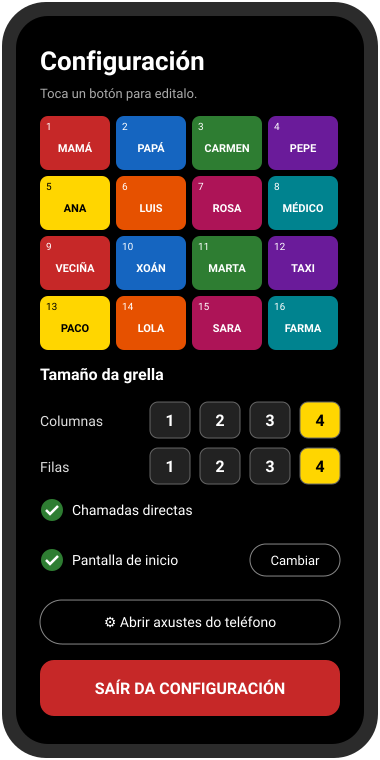
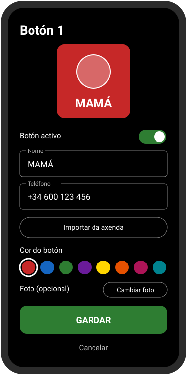

<div align="center">


<br>

**Un botón, unha chamada: o teléfono máis sinxelo para os maiores da casa**

Unha pantalla de inicio para Android con botóns grandes de cores que chaman directamente
á familia. Sen menús, sen iconas e sen maneira de perderse.

<br>


</div>

<br>

<div align="center">
<table>
<tr>
<td align="center"><br><sub><b>Inicio</b> — a grella de contactos</sub></td>
<td align="center"><br><sub><b>Configuración</b> — o menú oculto</sub></td>
<td align="center"><br><sub><b>Editor</b> — nome, teléfono, cor e foto</sub></td>
</tr>
</table>
</div>

## Por que

Precisaba dun teléfono que a miña avoa puidese usar soa. Un smartphone normal está cheo de
iconas, menús, notificacións e avisos que aparecen sen pedilos, e calquera toque de máis
acaba nunha pantalla da que non sabe saír. Os teléfonos "para maiores" son caros e
tampouco se adaptan á familia de cada un. 'ChamaXa' é o contrario: botóns grandes cos
nomes (e as caras) da xente da casa, e un toque para chamar.

## Funcionalidades

- 📞 **Chamada cun só toque** — botóns grandes de cores que ocupan toda a pantalla; cada un chama directamente, sen pasar polo marcador
- 🔠 **Nomes grandes** — en negriña e o máis grandes posible: o texto redúcese só o xusto para caber, sen partir palabras
- ✋ **Anti-dobre pulsación** — tras un toque, todos os botóns quedan bloqueados 3 segundos (útil se hai tremor ou nerviosismo)
- 📳 **Vibración** — cada pulsación nótase na man, non só se ve
- 🏠 **Pantalla de inicio** — substitúe o escritorio do teléfono: sen barras, o botón Atrás non fai nada e Inicio sempre volve aquí
- 🔒 **Menú oculto** — mantendo premido 10 segundos o botón superior esquerdo. Se ninguén o toca en 3 minutos, volve só á grella
- 🔢 **Grella a medida** — de 1 a 4 columnas e de 1 a 4 filas: 4 × 4 para 16 contactos, ou 2 × 3 para botóns enormes
- ✏️ **Editor de botóns** — nome, teléfono, cor (8 de alto contraste) e activar ou desactivar cada botón desde o propio móbil
- 📇 **Importar da axenda** — escolles un contacto e enche o número (e o nome, se estaba baleiro)
- 📴 **Sen Internet** — os contactos gárdanse só no teléfono; a app nin sequera ten permiso de Internet

## Configuración

### Requisitos

| Requisito | Detalle |
|---|---|
| **Android 5.0+** | Con tarxeta SIM para chamar (probado nun Moto E de 2ª xeración) |
| **Android Studio** | Só para compilar e instalar a app (o JDK 17 xa vén incluído) |

### 📲 Instalar

**Cun APK xa compilado**

1. Copia `ChamaXa.apk` ao teléfono (cable USB, correo, Drive…) e ábreo desde *Arquivos*.
2. Android avisará dunha **fonte descoñecida**: toca *Axustes* e permite instalar desde esa app.
3. Toca **Instalar**. Se aparece *Google Play Protect*: *Máis detalles → Instalar igualmente*.

**Desde o código fonte**

1. En Android Studio: *File → Open* → a carpeta do proxecto (a que ten `settings.gradle.kts`).
   A primeira sincronización descarga Gradle 8.11.1 e as dependencias.
2. Activa a *depuración USB* no móbil, conéctao e preme **▶ Run**.
3. Para xerar un APK para outros teléfonos: *Build → Generate Signed App Bundle / APK…* → **APK** → **release**.
   Garda a chave `.jks` e os contrasinais: sen eles non poderás publicar actualizacións.

### 🏠 Primeira posta en marcha

1. Abre ChamaXa e **acepta o permiso de chamadas**. Sen el, cada botón abre o marcador e hai que tocar o botón verde.
2. Configura os contactos (mira o apartado seguinte).
3. Fai que ChamaXa sexa a **pantalla de inicio**: botón *Configurar* no menú, ou preme Inicio → **ChamaXa** → **Sempre**.
4. Proba unha chamada con cada botón.

### 📇 Configurar os contactos

Mantén o dedo sobre o **botón superior esquerdo durante 10 segundos** sen soltar: o teléfono
vibra e ábrese o menú de configuración. Un toque curto nese botón segue chamando como sempre.

Toca un botón para editalo e preme **GARDAR**:

| Campo | Que fai |
|---|---|
| **Botón activo** | Se o desactivas, a cela queda baleira e non chama a ninguén |
| **Nome** | O texto do botón (ata 20 caracteres). Os nomes curtos len mellor: *MAMÁ*, *XOÁN*, *MÉDICO* |
| **Teléfono** | Admite espazos e prefixo (`+34 600 123 456`). Tamén vale un fixo |
| **📇 Importar da axenda** | Escolles un número da axenda; se o nome estaba baleiro, tamén o enche |
| **Cor do botón** | 8 cores de alto contraste. Sobre fondos claros o texto pasa a negro só |
| **Baleirar este botón** | Borra todos os datos do botón (hai que premer **GARDAR**) |

No mesmo menú:

- **Tamaño da grella** — columnas (1–4) e filas (1–4). Os contactos que quedan fóra non se borran.
- **Chamadas directas** e **Pantalla de inicio predeterminada** — ✅ ou ⚠️, cun botón para arranxalo.
- **⚙ Abrir axustes do teléfono** — wifi, volume, desinstalar…
- Se ninguén toca o menú en **3 minutos**, volve á grella e descarta o que non se gardou.

### 🔐 Privacidade e permisos

ChamaXa **non ten permiso de Internet**: non envía nada a ningures.

| Permiso | Para que |
|---|---|
| `CALL_PHONE` | Facer a chamada cun só toque |
| `VIBRATE` | Vibrar ao premer un botón |

Non pide acceso á axenda nin á galería: usa os selectores do sistema e só recibe o que escolles.
Os contactos gárdanse en `SharedPreferences` e as fotos en `files/fotos/`; bórrase todo ao desinstalar.

### ⚙️ Parámetros axustables

Ao comezo de `MainActivity.kt`:

| Constante | Por defecto | Descrición |
|---|---|---|
| `TAMANO_TEXTO` / `TAMANO_TEXTO_MIN` | `32.sp` / `14.sp` | Tamaño máximo e mínimo do nome |
| `MAX_COLUMNAS` / `MAX_FILAS` | `4` / `4` | Tamaño máximo da grella |
| `BLOQUEO_CHAMADA_MS` | `3000` | Bloqueo anti-dobre pulsación |
| `TEMPO_ACCESO_ADMIN_MS` | `10000` | Tempo para entrar no menú |
| `INACTIVIDADE_ADMIN_MS` | `180000` | Inactividade antes de saír do menú |
| `PALETA` | 8 cores | Cores dispoñibles para os botóns |

## Estrutura xeral

```
chamaXa/
├── settings.gradle.kts                   # Proxecto e módulos
├── build.gradle.kts                      # Versións de AGP e Kotlin
├── gradle.properties                     # Opcións de Gradle
├── gradle/wrapper/                       # Gradle 8.11.1
│
├── app/
│   ├── build.gradle.kts                  # SDK (minSdk 21, targetSdk 35) e dependencias
│   ├── proguard-rules.pro
│   └── src/main/
│       ├── AndroidManifest.xml           # Permisos, tema e pantalla de inicio
│       ├── java/es/ipardelo/chamaxa/
│       │   └── MainActivity.kt           # Toda a lóxica e a interface
│       └── res/
│           ├── drawable/ic_launcher.xml  # Icona (grella de cores)
│           ├── values/strings.xml        # Inglés (idioma por defecto)
│           └── values/themes.xml         # Tema escuro a pantalla completa
│
└── assets/                               # Banner e capturas do README
```

## Evolución por versión

### v0.7.0
- **Editor de cada botón**: nome (ata 20 caracteres), teléfono, cor e botón activo/desactivado.
- **Importar da axenda**: Android só lle pasa á app o número escollido, sen permiso de contactos.
- Validación do nome e do teléfono antes de gardar.

### v0.6.0
- **Menú de configuración oculto**: manter premida 10 segundos a primeira cela. Un toque curto segue chamando.
- **Tamaño da grella**: de 1 a 4 columnas e de 1 a 4 filas. Os contactos que quedan fóra non se borran.
- Estado do permiso de chamadas e do launcher, cun botón para arranxar cada un.
- Se ninguén toca o menú en 3 minutos, volve á grella e descarta os cambios.

### v0.5.0
- ChamaXa xa pode ser a **pantalla de inicio** do teléfono.
- En Android 10+ ofrécese o diálogo do sistema *Usar como app de inicio*.
- Instalable tamén en tablets sen telefonía, para probala.

### v0.4.0
- **Anti-dobre pulsación**: tras un toque, os botóns bloquéanse 3 segundos e os demais vense atenuados.
- **Vibración** clara en cada pulsación.

### v0.3.0
- **Grella principal** a pantalla completa e sen barras do sistema. O botón Atrás non fai nada.
- **Chamada directa** cun toque; se non hai permiso, ábrese o marcador.
- Nomes en negriña que se reducen só o xusto para caber.
- Aviso na primeira execución, cando aínda non hai contactos.

### v0.2.0
- Modelo de contacto (nome, teléfono, cor, foto e activo) e de grella.
- Persistencia en `SharedPreferences` con JSON, sen bibliotecas externas.
- Paleta de 8 cores de alto contraste.

### v0.1.0
- Proxecto Android con Kotlin e Jetpack Compose (Material 3), `minSdk 21` (Android 5.0).
- Tema escuro a pantalla completa e icona provisional.

## Folla de ruta

- [ ] Fotos nos botóns
- [ ] Tradución ao galego e ao castelán
- [ ] Icona definitiva (*adaptive icon*) en `mipmap`

## Autor

[Ismael Castiñeira](https://ipardelo.es)

```bash
VIVA GHALISIA E A COSTA DA MORTE! 💀
```
